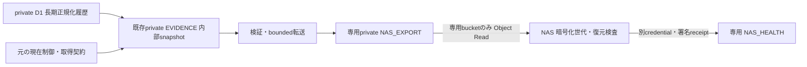

# NAS専用exportの分離と初回Cloud実行準備

2026-10-18。所有者はHighreso/Rebroの「非公開・個人研究限定の例外」と長期保存を承認した。提供者の許諾は引き続き `unconfirmed`、通常sourceの権利grantは変更しない。正規化履歴は `owner_continuing` とし、30日・10年を削除TTLにしない。レビュー期限切れは取得／利用停止であり、保存終了ではない。明示的な保存終了・取消しは復元後にも適用する。

承認記録は [判断票](personal-execution-20261018/private-start-approval.review.json)。**初回・日次の実収集、Cloudリソース作成、remote migration、deploy、実鍵設定、NAS実機変更は未承認・未実施**。今回の変更はコード・停止状態の設定案・ローカルsynthetic検証に限る。

## 保存と転送の境界

- 元のCloud契約の `cloud.bucket` は取得証拠／現在制御のorigin。過去の契約・hash・観測IDを転送先変更のために書き換えない。
- 新しい `personal-nas-export-v1` は転送設定。account、private DB、origin/export/health bucketをpinする。exportとorigin/healthの同名、同一binding、pin不足を拒否する。実bucket名は未定なのでnullのまま。
- `NAS_EXPORT` はCollector専用の追加候補binding。Public Workerには付与しない。稼働中のWrangler、source、Cron、API、Adminは変更していない。HTTP操作口も追加しない。
- exportへ渡すのは検証済みの正規化snapshotのpart、manifest、catalog、復元に必要な制御情報だけ。raw HTML、PoC／ECB／Modelsの証拠、取得用Secret、元bucketの任意object、staging snapshotやleaseをコピーしない。取得契約と許された出典は正規化snapshotに含む。
- NAS clientの設定は `personal-nas-runtime-v2` / `daily-nas-runtime-v2`。旧shared-bucket設定は自動移行せず拒否する。daily NASのsnapshot照合用bucketはorigin、S3接続先bucketはexportとして分離する。

R2のObject Readはbucketを指定できるが、アプリのprefix allowlistはIAMの代わりにならない。[Cloudflare R2公式認証資料](https://developers.cloudflare.com/r2/api/tokens/)に沿って**専用export bucketだけ**を対象にする。元EVIDENCEを読めるcredentialはNASへ渡さない。healthには別bucket／別credentialが必要で、Object Read/Write自体は固定receipt以外も操作できる権限である。clientの固定PUTとHMACだけをIAM制限だと表現しない。

## 部分失敗、取消し、長期運用

`src/research/nas-export.ts` はネットワーク取得やDB writeを行わない。既存の初回／日次maintenanceから呼び、export bindingが未設定なら新規取得の前に失敗する。既存のFX/Models処理とは別の例外境界にある。

制御の投影を先に行い、originとexportの双方を20 objectずつcursorで走査する。originの現在制御が欠落した場合はgateを閉じる。exportにある前回sequenceは巻戻し検出用に残し、欠落を許可扱いにしない。取消しmarkerも残す。初回は現在headのみを往復2段階で走査し、選択中のreview・backup proof・取消しを個別に確認する。過去のbackup proof全件を走査せず、年数に応じた無駄な遅延を避ける。日次制御はauthority／削除markerの往復4段階で、20件を越える場合は次回へ継続する。5分leaseとorigin側checkpointを使う。

転送中はsource・初回/日次別のgateを `ready=false` にする。partのsize/hash、snapshotの契約・source・行・列・出典・時刻を照合し、part→manifest→catalog/current control→readyの順に確定する。Cloudの2bucket間に原子transactionがあるとは仮定しない。manifest前のwrite失敗、missing part、control欠落、旧pinでは採用不可。次回の保守で保存済みのデータから再開し、価格ページを再取得しない。

確定後は最低10分の読取窓を残し、5分timerが常に次の未完了走査へ衝突することを避ける。この間checked_atを延長せず、新しいsource取消しは待機を飛ばして伝播を始める。NASは各GETの前後に同一generationのgateを確認する。未完了・欠落・未来時刻・48時間以上古いgate、途中のgeneration変更は失敗。404の取消しmarkerを「取消しなし」と判断できるのはこの検査を通った場合だけ。originの変更は次の保守・制御走査で伝播するため、即時同期とは主張しない。走査中・障害中はNAS採用／復元を止め、古いバックアップを現在制御として復元しない。

日次データは1回最大1run、最大512KiB／4part。最新runの新しい世代を優先し、その後は過去runをcursorで巡回する。catalog pageも別cursorで巡回し、manifestが無い失敗／削除済みrunを伝える。数千runを一度に転送・transaction化しない。NAS側は欠けたpartや未転送runをcomplete扱いしない。

exportの期限切れ世代と明示的取消しデータを20 objectずつ削除する。停止marker・current controlには年齢TTLを設けない。NASはmanifestが消えた後でも取消しmarkerを先に記録し、保持していた暗号化コピーを削除する。正規化D1履歴に年齢TTLを追加していない。backup世代の90日は履歴保存期間ではない。

通常の日々の処理はCollectorの既存slotとNAS timerで継続する設計で、日々の価格転記や手動exportはない。初回のみのNAS poll候補は60分、**日次・長期履歴用は5分**。既存NASの1回最大20runという上限では、1時間pollだと10年分の全inventoryを2日で回れないため。5分なら理論上5,760run/日、2sourceで各3,650runの巡回を2日以内に収める余地があるが、実処理時間・R2操作数・停止時間を含めた容量検証は未実施。上限を巨大化せず、バックログ／inventory鮮度で停止・警告する。Cloud側も日次の新runを優先し、残枠で古い世代を更新する。高負荷時のCPU・費用・90日以内の全世代更新は実環境の受入事項。

## 初回Cloud実行の準備と残件

[停止状態の構成案](personal-execution-20261018/nas-export.setup-proposal.json)はWrangler入力ではない。既存account/DB/bucketの値はGit参照であり、今回本番へ再照会していない。新bucket名・鍵・NASパスは推測しない。

1. **実施前レビュー**: 現行本番CollectorのversionとGitのdriftを再確認し、このmain由来branchを直接上書きdeployしない。採用commit・migrationの適用済みjournal・対象accountを照合する。今回のexport分離自体には追加migrationはない。既存0007〜0014の未適用分は別途明示承認が必要。
2. **source契約**: 新しい [Highreso](personal-execution-20261018/highreso_public.cloud-method-v2-draft.json) / [Rebro](personal-execution-20261018/rebro_public.cloud-method-v2-draft.json) はmethod v2の初回専用案。所有者の継続保存承認refだけを反映し、実行承認・開始/終了時刻・鍵ID・resource pins・terms/robots fingerprintは未設定。旧method v1契約案は履歴として維持する。初回24時間窓・各source1試行・3 GET・15秒・内部retryなし。
3. **規約・構造の受入**: 私的例外と継続保存を再承認する必要はない。提供者の許諾とは別に、未解決条件を契約へ記録し、適用評価・固定fingerprintを確認する。Highreso旧国内版は2026-10-31T15:00Zで新規取得停止。以後は別の新版評価・hashを使う。Rebro別サイト規約の未特定を解決済みにしない。前回構造確認はHighreso48枠で余裕0、Rebro4事例。今回はサイトへアクセスしていない。
4. **resourceとIAM**: 所有者承認後にprivate export bucketを作成し、非公開・lifecycle・コピー一覧を確認する。NAS data credentialでexportのGETが成功し、元EVIDENCE・healthのGET、exportのPUT/DELETEが拒否されることを実物で確認して `isolation_review_ref` に記録する。source snapshotの本文をログやGitに出さない。
5. **鍵とNAS**: 専用UID／ACL、暗号化保存先、同期/snapshotコピー範囲、restore identity、別保管の回復鍵を確認する。MFAの鍵を流用しない。実鍵・credentialをCodexへ渡さない。実機の空staging復元・通信断・復元後の取消し再適用を確認してからNAS timerを承認する。
6. **本番反映と初回取得**: 確認済みbindings・契約hash・transport pinをCollectorのみに設定し、最初はmaintenanceのみ。専用bucketとNAS採用の受入後、各sourceの具体的な初回取得窓と初回flagを明示承認する。日次flagは別の継続実行承認まで停止する。既存sourceやCron、Public Workerを変更しない。

実効IAM、real NAS custody／復元、Cloud CPU／運用費、独立deadman監視の接続はローカルsyntheticでは証明できない。外部通知は設定・送信していない。実収集と本番稼働は0件／0日を維持する。

## 検証

[ローカル検証記録](nas-export-validation-20261018.md): 全件414テスト成功。最終コードの専用export 4件・独立した3つのMiniflare bucketを使うdaily NAS 3件も再実行して成功した。部分制御走査、欠落part、manifest write失敗、再実行、旧pin、stale gate、取消し、元の契約hash維持、専用export→age→空D1への初回／複数run復元を検証した。IAMの拒否試験はstubであり、本番credentialの実証ではない。
