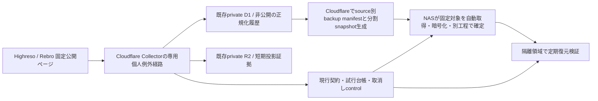

# Highreso / Rebro：Cloudflare初回収集とNAS保存の設定・承認案

後続の[実装・ローカルsynthetic検証](personal-cloud-nas-implementation-20261018.md)を追加した。以下は着手前の設定提案として保存する。実設定・本番・NAS実機は引き続き未実施。

2026-10-18 JST。**今回の成果は設定と実行契約の具体案。実収集、実契約の承認、権利grant変更、本番反映、鍵作成、NAS変更はしていない。** ローカルはsynthetic専用、初回実データもCloudflareで取得するという所有者の最新回答を反映した。

[機械可読の提案](personal-execution-20261018/cloudflare-nas.setup-proposal.json)は `executable=false` の設計資料であり、Wrangler・NAS CLI・`PersonalContractSchema` の入力ではない。承認欄・開始日時・鍵ID・本番実測は未確定のままにする。このJSONを既存CLIへ渡したり、statusだけ変更して実行しない。

## 1. 確認できたことと、今はできないこと

| 項目 | 状態と根拠 |
|---|---|
| 運用場所 | 所有者指定：Cloudflareで取得、NASへバックアップ。Windows PCの起動・ログインを日次運転の条件にしない |
| Highresoの利用主体 | 所有者申告：日本国内の個人。公開ページへの規約適用や提供者の許諾が確認できた意味ではない。都道府県の記載はこの設定に不要 |
| 提供者許諾 | 2社とも未確認。元のprivate3権限は `review_required`、sourceはdisabledのまま |
| 既存個人例外 | commit `560c872289ad0e9cb0253175918f59d2e29417ba`：ローカルv2の継続保存・追加review・暗号化snapshot・復元・停止状態のWindows保守案。production実行は拒否する |
| 既存NAS準備 | 別作業の `docs/backup-operational-monitoring.md` 第13〜14節を参照。F6-424 / TOS 7 / Btrfsの記録、既存capture対象はECB / Models.dev / Price of Compute。新しいnative確定工程は段階的な合成受入中 |
| NASの限界 | 当資料作成時に読んだ最終記録は第14.52節の固定helper配置。新工程の本番バックアップ成功、無人運転、Highreso/Rebro対応を証明していない。NASへ接続・操作していない |
| 鍵の保管場所 | 所有者申告：スマホ・クラウド・Cドライブ。アプリ、暗号化、独立した回復方法、既存age鍵の有無は未確認。MFA鍵とは別物 |

個人例外のローカル実装とNAS側の既存実装は別契約・別形式であり、接続済みではない。古いbranchのWranglerを現在の本番へそのままdeployしない。現行配信版との照合・差分統合が先に必要である。

## 2. 推奨する保存経路（未実装・未設定）

推奨案は既存private D1とprivate R2を再利用する。ただしpersonal authorityと専用namespaceを明確に分離し、通常source policy、public D1、公開APIへ昇格する経路を作らない。既存Collectorのdefault HTTPは閉じたまま、workers.dev / preview URL / routeを追加せず、AGENT_ENABLED=falseを維持する。API・Adminのbindingは増やさない。

| 保存物 | 具体的な配置案 | 確認・承認条件 |
|---|---|---|
| 正規化履歴 | `ai-investment-private`、既存研究migration候補の専用tableとpersonal authority | 最新本番schemaへ前進migrationを照合。既存migrationの再採番/上書き、remote適用はしない |
| 最小投影証拠 | `ai-investment-evidence-private` の新prefix `personal-research/evidence/<source_id>/` | sourceごと7日アクセス期限案。raw HTMLは保存しない。適合するlifecycleを別承認 |
| 確定backup | 同bucketの新prefix `personal-research/backups/<source_id>/` | 正規化履歴・取得時契約・訂正・必要なprovenanceのみ。短期証拠/HTML/Secretは含めない |
| 現行control | 同bucketの新prefix `personal-research/control/<source_id>/` | snapshot世代とは独立、年齢で消さない。取消し/削除tombstoneを古い復元物で上書きしない |
| NAS | **新しい専用保存領域案** `/Volume1/ai-investment-personal-research` | 未作成・未承認。既存本番share・合成G1〜G4・予約UIDを転用しない。TOS native ACL、Snapshot/ゴミ箱/同期範囲を受入 |
| NAS内の役割 | 上記root配下 `stage/`、`sealed/`、`control/`、`credentials/`、`restore-receipts/`、`status/` | 名称も提案。取得writerから確定世代・鍵・controlの書換えを分離。既存NAS coordinatorの受入後にpath/UID/ACLを固定 |

Cloudflare名/IDはGitの設定上の既存値を参照したもの。今回の本番照合結果ではない。NAS製品・保存先の記録も日付付きの参照であり、空き容量・実効ACLの最新測定に代えない。新DB・新bucket・archive分割はこの案に含めず、既存bucket権限の広さを許容できない場合に限り別設計を提示する。

既存NASの全private D1 dumpは新しいpersonal tableも含み得る。allowlistに2sourceを足すだけで許可しない。既存バックアップがpersonalデータを暗黙取得しないこと、未知schema/sourceなら停止することを統合テストし、新経路はsource別projectionをCloudflareで生成してNASへ渡す。NASへD1 tokenを新規配布する必要のない接続案とする。

## 3. 初回実行契約案（sourceごとに別承認）

| 項目 | Highreso | Rebro |
|---|---|---|
| source ID / dataset | `highreso_public` / `gpu_rental` | `rebro_public` / `gpu_secondary` |
| データURL | `https://soroban.highreso.jp/compute/instances` | `https://gpu-kaitori.com/reason/` |
| 対象 | 明示されたA100/H100のインスタンス条件・GPU仕様/台数・時給/月額・容量・明示費用条件 | 選別掲載のA100/H100買取事例の品名・年月・数量・単価。取引相手情報は除外 |
| 意味 | 提示価格。稼働率・実際の約定価格ではない。地域/税/契約の未知はnull | 掲載事例。全市場の実売feedではない。掲載月は約定時刻ではなく、消失は成約ではない |
| 監視規約URLの既存候補 | `https://soroban.highreso.jp/terms` | `https://gpu-kaitori.com/rules/` |
| 未解決事項 | 公開ページへの適用、11/1改定版と監視URLの一致、取得/保存/分析の根拠 | 別のサイト規約の所在、査定/買取目的以外の制限の適用、取得/保存/分析の根拠 |

共通の契約案：

- authorityは所有者の個人研究例外。`provider_permission=unconfirmed` を維持し、通常sourceのgrantは変更しない。Cloudflareでの処理とNASコピーも例外判断の対象として明記する。回答がないことを許諾として扱わない。
- **初回は各source累計1試行**。固定data1ページ、robots/termsを含む最大3 GET、各15秒、最大1,000,000 bytes/応答、入力最大100行・正規化最大48観測、内部retryなし。失敗も試行を消費し、source ID/日付/契約更新/restoreで初回予算を再発行しない。
- 承認後に確定するTから最大24時間の実行窓。Tはreadiness全充足後の未来時刻とし、今はnull。規約review期限を超えない。Cloudflareの次の承認済み自然スロットで開始する方式を提案し、手動HTTP操作口は作らない。
- robots/termsの固定fingerprint・適用版・scope・method・設定hash・実行artifact/version・保存/バックアップ条件を承認時に固定する。既存の調査hashを承認値へ自動コピーしない。
- 許可された正規化履歴は継続保存。原契約を書き換えず、保存/分析判断の更新はappend-only reviewにする。取得停止・分析停止・保存終了・削除義務を分ける。
- 403/429、robots拒否、規約変更、challenge、構造変更、未知比較条件はsource単独の停止/隔離。片方の失敗で他sourceやECB/Models等を止めない。外部LLM、公開、再配布、raw HTML archiveは対象外。

国内個人という申告でHighresoの所在地の不明は解消したが、規約適用や取得許諾は確定していない。既存の旧版向け境界 **2026-10-31T15:00:00Z（11/1 00:00 JST）** を越える初回契約は作らない。準備が改定後になる場合は新版・監視URLを再審査する。これは既存の保守的停止設計で、法的発効時刻の断定ではない。[既存調査](public-gpu-rights-review-20261018.md)を参照。Rebroの未特定条件は例外判断へ明示し、既知の規約に違反しないという保証を作らない。

**継続の日次収集は別の契約と実装。** 初回1試行の制限を解除する「契約更新」にはしない。日次契約の追加承認とsynthetic受入が済んだ後は、1日1回の自動取得・同価格再観測・訂正/欠測を人手なしで蓄積する。

## 4. 長期保存とバックアップの初期値案

| 対象 | 提案 | 意味・停止条件 |
|---|---|---|
| 正規化履歴 | owner_continuing、年齢による削除なし | 30日/3650日で削除しない。明示された継続保存判断の有効性が前提。明示的な削除義務は優先 |
| 最小投影証拠 | 7日、NASコピーなし | 元の取得時刻からの絶対期限。NASにはhash/出典等の許可されたprovenanceだけを渡す |
| R2/NAS backup世代 | **毎日・90日・最大96世代/source** | ローカル旧案の7日/8世代からの提案変更で、まだ未承認。各世代はその時点の全保管対象履歴を再構成できるため、世代交代で初日の観測を消さない |
| D1 Time Travel | Git記録はPaid/30日。本番再確認必須 | ユーザー向け履歴の保持期間ではない。明示削除後にも復元コピーが残る条件を承認に含める |
| control / 契約履歴 | 有効な履歴・復元候補がある限り保持 | backupと一緒に90日で失効させない。必要な取消し/削除記録を維持 |
| 復元検証 | 新規確定世代を日次で自動検証、鍵回復訓練は初期設定時と年次/変更時 | 前者は無人、後者は例外的な所有者確認。まだ未実装/未設定 |
| 目標 | backup RPO 24時間、災害時RTO 48時間 | 受入目標であってSLA/達成実績ではない。source再取得で失った過去を埋めない |

90日はbackupの世代寿命であり、履歴本体の寿命ではない。新しい全履歴世代の完全性・復元性を確認してから通常の世代交代を行う。新しいbackupが作れない場合は警告し既存候補を守るが、既に承認された絶対削除期限を無断延長しない。期限内に回復できない場合のコピー削除とデータ損失可能性を表示する。失敗・途中世代にも期限/削除処理が必要である。

長期履歴を既存の48行/512KiB単一snapshotへ押し込まない。固定cutoff、分割page、hash付きmanifest、checkpointとlease、controlの前後照合、全chunk確定後のcompleteを実装する。過去全量を復元できることを検査し、部分取得をcompleteにしない。上限だけを引き上げない。

D1 Time Travelは常時有効で、Paid30日/Free7日の復元窓を持ち、復元はDB全体の上書きになる。短期のTime Travelは10年履歴の代替ではない。[Cloudflare公式](https://developers.cloudflare.com/d1/reference/time-travel/)

R2 lifecycleの削除は非同期であり、7日ぴったりの物理消去を保証しない。read gateと削除確認を分け、確定した義務が基盤の残留条件に適合しないsourceは保存前に停止する。[Cloudflare公式](https://developers.cloudflare.com/r2/buckets/object-lifecycles/)

## 5. 鍵・資格情報：MFAとは別に扱う

| 種類 | 初期設定案 | 秘密情報を置く範囲 |
|---|---|---|
| Cloudflareログイン/MFA | 今回変更しない | 所有者が既に管理しているもの。backup暗号鍵へ転用しない |
| Worker→D1/R2 | 既存bindingを使用 | NAS用API tokenをCollectorへ追加しない |
| NAS→R2 | 対象bucket限定 **Object Read only / Workers R2 Storage Bucket Item Read** のS3資格情報 | NASの専用credentials leafだけ。固定bucket/prefixのLIST/GET、PUT/DELETE/REST fallbackなし。発行・設置は別承認 |
| NAS backup暗号化 | NAS既存候補のage方式に合わせる。取得プロセスには公開recipientのみ | 秘密identityはcapture/Exporter/Prometheus/Adminから読めない領域 |
| 無人の復元検証 | 専用restoreプロセスに限定したオンラインidentityを一時ROで渡す | 日次検証のために毎回所有者が鍵を入力する設計にしない。オンライン復号鍵がNAS上に存在する残存リスクを明示して承認 |
| 災害時の回復 | 同じ必要鍵を、NASとは独立した所有者の暗号化vaultに回復用として保管 | スマホとクラウドから新端末へ回復できることを合成データで確認。Cドライブは補助コピー。製品/回復方法は未確定 |

S3のObject Read onlyはbucket単位であり、アプリのprefix allowlistをtokenの権限制限だと説明しない。既存bucketを使う案では、資格情報漏えい時に同bucketの他objectも読める残存範囲を承認対象にする。これを許容しない場合は独立bucket等の別案が必要で、この案のまま有効化しない。[Cloudflare公式](https://developers.cloudflare.com/r2/api/tokens/)

Cloudflare上のR2 objectは基盤側で暗号化されるが、NASのage暗号化や所有者の回復鍵の代わりにはならない。[Cloudflare公式](https://developers.cloudflare.com/r2/reference/data-security/) 現行ローカルv2のAES-GCM/Windows DPAPIとNAS age形式には未実装の接続があり、暗黙に互換と扱わない。

ageは公開recipientで暗号化し、対応する秘密identityで復号する。[age公式の仕様・使用例](https://github.com/FiloSottile/age#usage) 初期作業は、所有者環境で鍵生成 → 公開recipient/非秘密key IDだけを設定 → protected NAS identityと独立vaultを設定 → **PC故障を想定した別環境でsynthetic復元** → アクセス拒否確認、の順。Codex・チャット・Git・HTML・通常log・diagnosticsへ秘密値を出さない。鍵作成/保存/rotationは今回行わない。旧世代に必要な鍵をrotationだけで削除しない。

現行controlはCloudflareとNASの保護領域へ世代/整合性確認付きで複製し、data復元と別に扱う。NAS writerが両方を巻き戻せない境界を検証する。最新controlを確認できない状態では解析/本番再開をしない。Cloudflareと最新controlを同時に失った災害は、古いreceiptがあるだけで最新と断定せず、所有者の例外的な照合・再承認が必要になる。

## 6. 日々の手作業を不要にする保守案

初期収集契約の間は「毎日取得」を起動せず、取得した履歴に対する保守を無人化する。後で日次取得契約を承認した場合も、同じ保守を使う。

| 自動処理 | 初期提案 | 失敗時 |
|---|---|---|
| Cloudflare dispatch | 既存Wranglerのスロット内でsource別の一回契約を評価 | HTTP前の契約/期限/試行台帳検査。新Cron・二重deployを足さず、最新本番のCPU/continuation余力を受入前に測定 |
| 保持・backup準備 | 取得完了後にsource別checkpointを進める | データ再取得をせず再開。取得不可でも許可された保管・削除義務の処理は継続 |
| NAS取得 | 1時間ごとに確定manifestを確認。新しい日次世代だけ取得 | 出所へのGETとは別。429/Retry-After尊重、有限backoff、元attempt継続、部分世代を確定しない |
| NAS確定/保守 | 独立readback後admission。期限/容量/取消しを毎時確認 | 旧確定世代をcapture writerで上書きしない。leaseの単純TTL削除や未知processの強制終了はしない |
| 復元検証 | 毎日、新規確定世代を一時隔離先で検査 | 本番D1へimportしない。検証metadataだけ記録、平文/鍵は恒久保存しない |
| freshness/backup監視 | backup age 26時間でwarning、48時間で当該sourceの新規取得停止を提案 | 履歴削除はしない。通知経路と復旧条件も含め承認。初回は同日backup成功まで追加取得しない |
| review期限 | 14/7/1日前に通知、期限で取得/read停止 | 同じ文面でも許諾を自動更新しない。例外的なレビューだけ人が判断。過去契約と保存判断を維持 |
| scheduler欠報 | NAS外の独立監視でheartbeat欠測を検出 | NAS内監視だけでNAS停止を検知できるとしない。監視先・通知先・scheduleは未設定 |

既存NAS候補には `restart: no` の一回実行や手動承認を前提とする工程も残っている。systemd/TOS scheduler/native coordinatorの無人接続・再起動復帰・自動期限処理は、この表の動作に合わせて実装・受入する必要がある。毎日TOS Terminalでコマンドを実行することを正常運転の条件にはしない。権利判断・規約変更・鍵回復・未解決leaseは例外対応である。

## 7. 実装・受入の残件

1. 最新本番Collector/tree/schemaをread-only照合し、個人例外のproduction専用契約とdispatchを別差分で実装。既存のproduction拒否を単に外さず、承認済みsource/一回予算/保存境界を本番でも強制する。
2. 0010〜0012等の前進migration候補を実schemaと照合。既存0004/0005等や未適用作業と衝突させず、既存private/public履歴・FX/AI/PoCを保持する。
3. source別backup exporter、bounded snapshot、NAS側manifest契約、current control複製・復元拒否を実装。既存NAS全DB captureとの交差を否定するテストを追加する。
4. NAS側の独立確定工程の受入と調整し、専用保存領域・ACL・copy台帳・暗号化・自動保守を準備。既存の試験slot・使用済みUID・未コミット作業を変更しない。
5. syntheticで一回試行の冪等性、改定日停止、日次化の別承認、長期全履歴の分割復元、部分/障害/中断、NAS停止、clock逆行、revocation後の古い復元、鍵紛失、公開境界を検査する。
6. 最終候補のcheck/test/test:runtime/dry-run build、offline preflight、migration/境界・容量検査を実施。合成10年時計は10年稼働や日次件数の性能保証と区別する。

## 8. 所有者が確認・承認する項目

設定値とartifactを固定してから段階ごとに確認する。この資料への同意だけで本番作業や実収集を開始しない。

| 段階 | 確認・承認内容 | 現在 |
|---|---|---|
| A 設計 | 上記Cloudflare→NAS構成、NAS専用保存領域案、継続履歴と日次90日backup、RPO/RTO、オンライン復元鍵の扱い | 方針は確認済み。具体値・追加実装は提案 |
| B 非秘密の初期情報 | 使用する暗号化vaultのアプリ名・PC/NAS故障後の回復方法、通知先と独立監視先、NAS専用領域のSnapshot/ゴミ箱/同期条件 | 未確認。鍵/パスワード本文は不要 |
| C source実行契約 | sourceごとの未確認事項を含むowner例外判断、Cloudflare/NAS処理・コピー、継続保存/明示終了条件、現行規約・hash、初回1試行とT〜T+24h | 未承認。提供者grant変更ではない |
| D 初期設定 | 最終path/ACL/key ID/recipient、限定R2資格情報、NAS scheduler/保守/監視の具体差分 | 未実装部分あり。発行・配置・登録は未承認 |
| E 本番反映 | 最新配信版を基準にしたmigration/Worker/lifecycle/設定差分とrollback、既存source/公開境界への非影響 | 未準備・未承認。日次収集契約を含めない |
| F 初回実収集 | C〜Eの実効確認後、source単位で一回だけ開始。結果・NAS確定・隔離復元を確認 | 未承認・未実行 |
| G 継続日次取得 | 初回受入後の別契約、再観測・訂正・欠測・障害時復帰を含む自動実行 | 未実装・未承認 |

rollbackは個人例外のdispatchだけを停止し、既存sourceのCronを止めない。取得済みの許可された履歴、契約、最新controlを維持し、保持/削除義務の保守を継続する。migrationのDROPやD1全体Time Travelを自動rollbackとして行わない。

## 9. 今回の検証範囲

提案JSONの整合性、全sourceの未承認・非実行、既存offline検査による拒否、リンク、元のconfig/grant/契約/コードの非変更をローカルで確認した。実行結果は同梱の[検証記録](personal-execution-20261018/cloudflare-nas.validation.md)を参照。Cloudflare公式資料は仕組みの確認のみで、Highreso/Rebroの価格取得、本番照会、NAS実機再検証はしていない。
