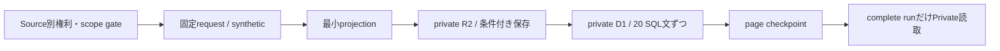

# Private研究用収集 — 実装契約と承認手順

対象はIssue #15のローカル候補。productionでは関数が `research_production_not_integrated` で停止し、既存Collectorからも呼ばれない。候補JSONはconfig/proposals/researchだけに置き、config/sourcesへコピーしない。本書は有効化計画であり実行承認ではない。

## 権利と公開境界

既存Source/PolicyとcanCollectを使う。ライセンスURLがnullでも、automated_collection/private_storage/internal_analysisの各allowedと適用根拠、期間、field scope、owner/wire/retentionレビューが揃えばPrivate処理できる。1項目でもreview_required/denied/expiredならHTTPより前に停止する。本PRでallowedを記録した実ソースは0件。

9権限は独立。候補では取得/保存/内部分析/表示/正規化再配布/派生再配布/商用再配布がreview_required、外部LLM/raw再配布がdenied。Private 3権限だけの合成grantで保存が成功し、既存canPublishはfalseを返す。新経路自身にpublic/raw/LLM exportは実装しない。public DB bindingを受け取らず、API schema/OpenAPIを変更しない。

sourceのfull config hashをresearch_sourcesへ固定する。同一policy版のscope/terms/endpoint/retention変更では再開を拒否する。owner承認後の新policy登録手順は別リリースで用意し、古い認可を勝手に復活させない。停止はsource suspended/current config mismatch/terms mismatch/valid_untilのいずれでも読取と収集に効く。

## 保存と復旧

- run IDはsource/policy/scheduled slot/query/synthetic区分で決定。再実行で履歴を増殖させない。翌日の同価格は別のreobserved観測。
- 同一runには5分lease。期限切れwriterのSQLはlease tokenで拒否。source単位の呼出しは分離され、あるsource失敗後も別sourceを処理できる。
- R2 captureはsource/run/page固定キー、初回writeのみ。失敗したpageは保存済みprojectionを使って復旧し、後刻の価格を過去時刻へ偽装しない。最大6時間を越えた取得/再開は別runとして再審査する。
- raw全体は永続化しない。evidenceにはtyped record、query/config hash、source/policy/terms/method、observed_at、synthetic、payload hash、page/coverage。EIA request envelopeや認証情報を除外。全responseのhashは内容同一性の証拠であり、本文を配布する許可ではない。
- EIAは1系列/最大12か月、6件×2page。JEPXは1地域/1日/48枠、年度input最大18,000行/6MB。R2 projectionは128KiB上限。入力limitを超えたらsourceだけ停止する。
- HTTPは既存bounded実装の20秒（body含む）、最大3試行、Retry-Afterを利用。長い待機はretry_atへ保存し同じrunの早過ぎる再試行を抑制。redirect、他endpoint、巨大body、HTML/schema変化を拒否。レスポンスからURLをたどらない。
- 取得済みpageと総数を照合、跨pageのrecord重複/total変化を拒否。partialは完全履歴として読めない。JEPX 48枠があって価格nullならcoverage complete・値欠測であり0にしない。EIA completeはAPIが報告した絞込結果の完了を表し、全対象月の公表を保証しない。
- 0007 observationsはUPDATE不可。previous_observation_id/change_kindでfirst_seen/reobserved/revisedを区別。大幅な価格変化だけでは隔離せず、条件変更/構造不良とは分ける。国内GPUは比較条件未確認ならnot_comparable、50%超の同条件変化はwarning付きobserved_change。
- 正規化履歴はmethod/source URL、公表日時nullable、対象期間/原通貨単位、観測/記録時刻、hashを保存。EIA月次periodを架空の月初観測日時へ置き換えない。

これは既存GPU/modelのライフサイクルを変更する実装ではない。国内GPU受入契約はprivate electricityテーブルへ投入しない。DCもschema/hash付きrevisionだけで、企業開示の自動抽出/永続化は次の承認単位。

## 保持と復元

候補のevidence 7日、別archiveなし、normalized 90日、backup上限30日はいずれも運用案。利用条件由来の法定期限という意味ではない。retention_limit_daysがある場合normalized+backupを含めて検査する。

- purgeResearchEvidence: 1回最大5run×4pageをR2削除。SQL checkpoint前に落ちたcaptureも対象。削除済みcheckpointを記録し同じ先頭pageに停滞しない。
- purgeResearchRun: expiryまたは明示revoke後、先にpurgingとして読取停止、最大20 observation/呼出しで削除。revokeはsourceをsuspendedにしてから行う。進行中leaseと競合する削除を拒否。全行削除後にpage metadataを削除し、本文を含まないpurged run記録を残す。
- 現在はローカル関数であり、本番の自動retention scheduler/R2 lifecycleは未接続。将来既存continuation内でbounded cleanupを呼ぶこと、backlogを検知することが有効化の前提。新Cronを勝手に足さず、日次手動削除を要求する運転にしない。
- 復元用snapshotに古いrightsがあっても、現行config/terms/suspensionを先に復元する。Private read gateを閉じてexpiry/revocation対象を再削除し、完了後にreadを再開。backup/Time Travelの実日数と削除義務をownerが確認する。
- 0007は既存テーブルの破壊的変更なし。rollbackは呼出し停止/無効化、権利の取消し、必要なretention処理。既存historyを戻したりDROP TABLEしたりしない。

## 初期コスト上限案

料金契約の変更は0件。以下は入力量/保持の**上限計算**であり、Cloudflareの実測CPU/課金/Free適合を意味しない。

| source | 予定正常要求 / 月 | 失敗retry込み上限 / 月 | 投影行 / 月 | input bytes上限 / 月 | R2投影の上限目安 |
|---|---:|---:|---:|---:|---|
| EIA | 31〜62（通常直近3か月で1page） | 186 | 372 | 186MB（1MB×186、retry含む） | 2page×128KiB×7日、約1.75MiB |
| JEPX | 31（年度fileを1日1回） | 93 | 1,488 | 558MB（6MB×93） | 1page×128KiB×7日、約0.88MiB |

同runの再開時はcaptureを再利用する。source/UTC日ごとに1runの一意制約、pageごとに再実行をまたいで合計3 HTTP試行の永続予算を実装した。query変更による同日の予算リセットは拒否する。新policy/source IDへの変更は別owner reviewのため、回数制限回避に使わない。本番統合ではこの上限と停止/再開を運用監視へ接続する。CPU/memoryは年度CSV解析をCloudflare互換runtimeで計測し、通常dayの差分機械feedが許可されるなら低負荷経路を優先する。

normalized 90日ならEIA最大1,080行、JEPX4,320行。JSONを1KiB/行と仮定した本文だけで約5.3MiB、index/metadata/backupは別。実測storage/rows read-writeを確認してから固定の課金額を見積もる。生の年度CSV/応答全体のarchiveはない。GPU/DC/メモリは未接続なので増分収集費0、将来feed価格や許可件数unknownを0円/無制限として予算化しない。

## Source別owner承認チェックリスト

各項目は未承認。すべて個別に判断し、一つのsource待ちで他のローカル作業を止めない。

### EIA CO / IND monthly

- [ ] 根拠: API Terms of Service + Copyrights and Reuse、出典・公表日・加工明記、対象price/period/state/sector/unitのみの適用を確認。
- [ ] 認証: キー存在は未確認、取得・登録しない。URLキー必須とIssueの禁止を解消する方法をownerが選択。架空header認証にしない。
- [ ] 権限: private 3権限を新policyで承認、public系は別審査、raw/LLMはdenied維持。
- [ ] 費用/量: 無料API、通常1〜2page/日、最大12行/日、上記月予算を承認。backfillは別承認。
- [ ] 保持: 7/0/90/30日と復元後削除、実Time Travel日数、terms review期限を確定。
- [ ] 受入: 正式wire契約、認証非露出、範囲外region拒否、月精度/単位/null、訂正/replay、期限切れ拒否を小規模live opt-in後に確認。
- [ ] 取消し/rollback: source単独停止、読取停止、revoke/purge、既存ECB/Models/PoCが動くことを確認。

### JEPX Tokyo 30分

- [ ] 根拠: 出典付き利用条件の自動取得・日次履歴保存への適用をowner確認。不可なら停止しOCCTOの特定系列を別審査。
- [ ] 認証: 公開CSV readerはキー不要。CSVの小規模live取得を別途許可してencoding/header/content-type/年度境界を確認。
- [ ] 権限: private 3権限だけ新policy、public/商用は未承認。wire_contract_review_refを根拠付きで記録。
- [ ] 費用/量: 1file/日、6MB/18,000input行/48投影行、月次上限とCPU計測を承認。
- [ ] 保持: 7/0/90/30、raw年度fileを保存しない、source別cleanupを受入。
- [ ] 受入: JST48枠、3月/4月年度切替、空欄/0/負値、部分日、重複、schema変更、429/5xx/timeout、捕捉済みpage復旧、再取得でも元観測時刻を保持。
- [ ] 取消し/rollback: source単独suspend、complete読取遮断、必要削除。本番統合前のため現在のrollbackは候補不採用だけで既存処理への影響なし。

### Highreso / GPUSOROBAN

- [ ] 根拠/経路: ownerによる未送信/送信済みを確認した上で、公式API/CSV/feedの書面条件、取得・保存・派生・再配布を個別確定。こちらから問い合わせない。
- [ ] キー: 要否・存在unknown。Secret読み取り/追加なし。
- [ ] 量/費用: 初期A100/H100/B200/B300のうち提供が確認されたSKUのみ、候補1page/50offer/日から協議。販売/契約費unknown。
- [ ] 保持: 7/0/90/30案を提供者条件と照合。許諾前にHTML全保存しない。
- [ ] 受入: hour/minute/month/point、専有/共有、GPU数、region証拠、税/最低契約/割込み。価格とavailabilityを別々に検証。
- [ ] 取消し: feed停止・既存GPU履歴への誤投入なしを確認。今回実装は受入型だけで本番接続なし。

### さくらDOK

- [ ] 根拠: API契約の履歴保存・内部分析・アカウント固有価格利用を確認。仕様書ライセンスをデータgrantにしない。
- [ ] キー: 本番metadataには2 Secret binding名があるが値/有効性未検証。この作業で使用しない。
- [ ] 量/費用: 既存adapterの50件/page・1page/invocationとsource scopeをreview、API単独費/rate unknownを解決。
- [ ] 保持: 既存候補retentionと提供者条件を照合し別policyで承認。
- [ ] 受入: is1aと地域根拠、begin/end日時、JPY/second、overridden/account-specific、pagination、empty/error分離。
- [ ] 取消し: source単独停止・現行public非表示維持・private削除/復元試験。既存認証/設定を変更せず受入契約だけ追加済み。

### Rebro / GPU買取センター

- [ ] 根拠: 公開事例と非公開成立seriesを区別し、正規の機械feed提供・匿名化・保存・利用範囲をowner/提供者が合意。非公開情報へ独自アクセスしない。
- [ ] キー: 要否・存在unknown、Secret追加なし。
- [ ] 量/費用: 初期A100/H100の許諾事例最大50件/日案、feed費/全期間coverage unknown。
- [ ] 保持: 7/0/90/30案と契約上限、個人/取引相手情報を受け取らないprojectionを承認。
- [ ] 受入: 4価格種別、month/day精度、実行根拠、lot数量/状態/税、出品消失≠成立、一業者≠日本全体。
- [ ] 取消し: feed停止、権利停止後のread/purge/backup確認。本PRに実価格/非公開成立例は0件。

### DC採択開示（METI候補）

- [ ] 根拠: 403を回避せず、公式資料と当該利用条件を確認。未解決なら仕様/テストまでで維持。
- [ ] キー: 公表資料には通常不要という想定だが機械取得経路未確定、認証追加なし。
- [ ] 量/費用: 週1差分・選定資料1件/回を初期案、PDF size/抽出CPU上限を実測して確定。
- [ ] 保持: 最小evidence7日/normalized90日/backup30日案。全文archiveは別許諾なしに作らない。
- [ ] 受入: project/site/phase、発表日/対象年度/観測日、planned/contracted/energized/IT operational、水3区分、取消/修正の追記を確認。
- [ ] 取消し: collector/永続化はまだ存在しない。次段階の実装時に停止・復元手順を受入。

## 統合時の順序（今回実行しない）

1. source単位の上記承認と不足仕様を解決。新sourceの具体的grantとscopeをレビュー可能な差分にする。
2. 本番稼働commitとmainのdriftを再照合。PoC enabled/profileを古いmainで上書きしない。
3. 0007の本番適用計画、Collector呼出し/日次予算/自動retention統合を別PRで提示。既存3 Cron以外のscheduleを増やさない。prod拒否の解除はその承認単位で行う。
4. ownerがremote migration/deploy/必要Secretを個別承認してから反映。先に無効状態で確認し、source単位で初回収集を承認する。
5. observation freshness・partial・429・retention backlog・日次予算を自動監視。正常運転にCSV転記、毎日のWeb巡回、手動download/uploadを要求しない。
